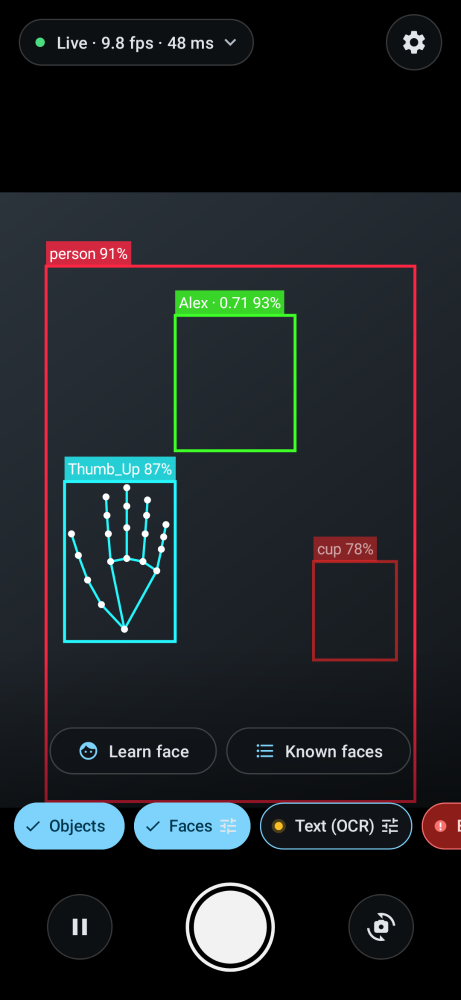
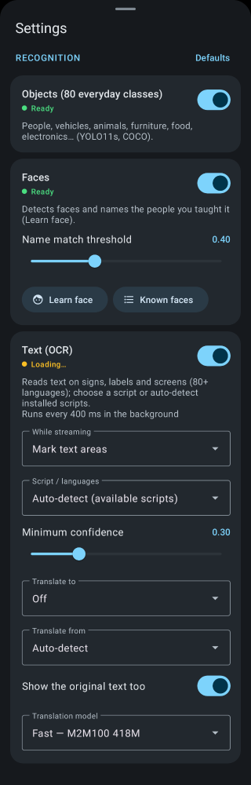
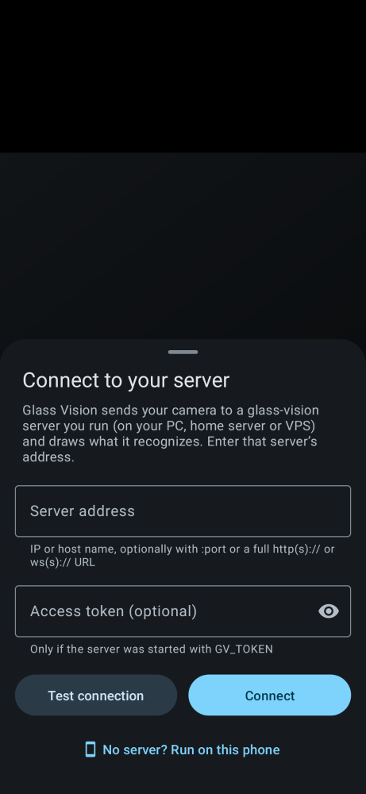

# glass-vision

**Point your phone at the world, let your own GPU tell you what it sees.**

glass-vision streams your Android phone's camera to a server you run (your gaming PC, a home server, a cloud GPU
box), runs several recognizers on every frame, and draws the results live over the camera view: boxes, labels,
skeletons, names. No cloud service, no account — the frames never leave machines you control.

It was built as a test rig for smart glasses (same protocol, different camera), so it is fast: ~10–30 ms per
frame on a desktop GPU, round trip around 50 ms over a home network.

| Live recognition | Recognizers | Connecting |
|---|---|---|
|  |  |  |

## What it recognizes

Each recognizer is a pipeline you switch on in the app; several can run at once.

| pipeline | what | model |
|---|---|---|
| Objects | 80 everyday classes: people, vehicles, animals, food, electronics… | YOLO11s |
| Find by text | anything you type: "red mug, keys, glasses" | YOLOE-11s + MobileCLIP |
| Faces | detects faces and names people you taught it ("Learn face") | InsightFace buffalo_l |
| Text (OCR) | sign lines grouped into blocks; PP-OCRv6 + script fallbacks, orientation and optional M2M100 translation | PP-OCRv6/PP-OCRv5 ONNX + M2M100 |
| Hand gestures | 21-point hand skeleton + 7 gestures (👍 👎 ✋ ✊ ☝️ ✌️ 🤟) | MediaPipe |
| Body pose | 17-point skeleton of every person | YOLO11s-pose |

You can run recognition **on the phone instead**: choose **On this phone** in Settings, or tap **Run on this phone**
on the first screen. Objects, gestures, pose, face detection and OCR run locally; MediaPipe models download from
Google the first time each feature is enabled. Find-by-text and face naming remain server-only. Phone OCR uses
Google ML Kit text recognition (Latin built in; Chinese, Japanese, Korean and Devanagari via Google Play services);
other scripts (Cyrillic, Arabic, Greek, Hebrew, Thai…) use downloadable Tesseract language packs, 41 in all, chosen
under **OCR language** in the Text card and downloaded on first use (then offline). Translation runs offline with
ML Kit into 50+ languages; each translation model downloads on first use. On-device mode is slower and uses battery;
first model downloads need internet.

**Read text**: with Text (OCR) on, the live view marks where text is. Tap **Read text** above the shutter: the app
takes a full-resolution photo, reads it (on your server, or on the phone in on-device mode) and opens a sheet with the
text grouped by sign, its translation, and **Add language** for more translations. Copy and share work from the sheet.
Prefer the old behaviour of reading every frame? Set **While streaming** to **Read live** in the Text card.

New pipelines appear in the app automatically: the server describes each one (options, actions) when the app
connects. Some models are **non-commercial only** — see [Model licenses](#model-licenses).

## Requirements

- **Server**: Linux with an NVIDIA GPU (driver ≥ 525; ≥ 580 recommended) and ~10 GB of disk. About 5 GB of GPU
  memory with every pipeline on (incl. OCR translation; the optional larger translation model adds ~1.5 GB). No GPU? It still runs on the CPU — just slowly (a few frames per second).
  macOS works CPU-only (best effort).
- **Phone**: Android 8+ (the app is in [Releases](../../releases)).
- Phone and server on the same network: your Wi-Fi/LAN, or [Tailscale](https://tailscale.com) from anywhere.

## Quick start

### Option A: Docker (simplest)

Needs Docker with the [NVIDIA Container Toolkit](https://docs.nvidia.com/datacenter/cloud-native/container-toolkit/latest/install-guide.html).

```sh
git clone https://github.com/GenorTG/glass-vision.git && cd glass-vision
cp .env.example .env
# edit .env: GV_BIND = this machine's LAN or Tailscale IP, GV_TOKEN = a secret (openssl rand -hex 16)
docker compose up -d
docker compose logs -f        # first start downloads ~3 GB of models, then "Uvicorn running on …"
```

No NVIDIA GPU: `docker compose --profile cpu up -d glass-vision-cpu`.

### Option B: Python venv (no Docker)

Needs Python 3.11 or 3.12 with venv (`sudo apt install python3-venv` on Debian/Ubuntu).

```sh
git clone https://github.com/GenorTG/glass-vision.git && cd glass-vision
scripts/install.sh
```

The installer detects your GPU and driver, picks the matching PyTorch build (CUDA 13.0, 12.6 or CPU), creates a
self-contained venv in `server/.venv`, downloads the models, asks which address to listen on and whether to
use a token, writes `server/config.env`, and can install a systemd user service. It prints the address to type into
the app at the end. Rerun it any time (it keeps your settings); `scripts/install.sh --help` lists every option,
e.g. for unattended installs:

```sh
scripts/install.sh --non-interactive --host 192.168.1.20 --port 8770 --generate-token --systemd
```

Without the service: `server/run -m glass_vision`.

## Connect the app

1. Install the APK from [Releases](../../releases) on your phone.
2. Enter the **server address** the installer printed — e.g. `192.168.1.20:8770` or your Tailscale IP — and the
   **access token** if you set one.
3. Allow camera access. Tap a recognizer chip to switch it on; long-press it for its options.

To use the phone without a server, tap **Run on this phone** (or choose **On this phone** under Settings →
Processing). Switch scripts and the translation target in the Text recognition card. The first use of a recognizer
downloads its model; the selected translation model downloads when a translatable line is first read.

Check the server from any browser on the same network: `http://<address>:8770/health`.

## Security

The server sees everything your camera sees. Treat it like a webcam:

- **Set a token** (`GV_TOKEN`, the installer offers to generate one). Without it, anyone who can reach the port can
  watch your stream and use the server. With it, every request but `/health` needs the token.
- **Never expose the port to the internet** (no router port forwarding). Bind it to your LAN address, or better,
  use [Tailscale](https://tailscale.com): install it on the server and the phone, and use the server's Tailscale IP
  (`tailscale ip -4`). The traffic is then encrypted end to end and reachable from anywhere you are.
- The default listen address is `127.0.0.1` (this machine only); `0.0.0.0` means every interface — only with a token.
- The stream itself is plain `ws://` (fine on a LAN or inside Tailscale's WireGuard tunnel). For anything else, put
  a TLS reverse proxy in front.
- Face recognition stores face embeddings of the people you enroll in the server's data directory. Only enroll people
  who agreed to it.

## Configuration

All settings are `GV_*` variables: in `server/config.env` (venv, written by the installer) or `.env` (Docker,
see [.env.example](.env.example)). Environment variables override the file.

| variable | default | |
|---|---|---|
| `GV_HOST` | `127.0.0.1` | listen address (venv; Docker uses `GV_BIND` for the host side) |
| `GV_PORT` | `8770` | port |
| `GV_TOKEN` | — | access token; empty = open |
| `GV_DEVICE` | `auto` | `auto` (first usable NVIDIA GPU, else CPU), `cpu`, `cuda:0`… |
| `GV_MODELS_DIR` | `server/models` | model weights |
| `GV_DATA_DIR` | `server/data` | face gallery, captures, the APK this server hands out |
| `GV_APK_PATH` | `<data>/app/glass-vision.apk` | APK served to phones for in-app updates |
| `GV_IDLE_UNLOAD_S` | `600` | free a recognizer's GPU memory after this many idle seconds |

## Updating

- **Server (venv)**: `scripts/update.sh` — pulls, reinstalls the pinned dependencies, checks the models, restarts
  the service.
- **Server (Docker)**: `git pull && docker compose up -d --build`.
- **App**: the app updates itself from *your* server. Put a release APK there once —
  `scripts/install.sh --apk`, or `python3 scripts/fetch_release_apk.py --repo GenorTG/glass-vision`
  (Docker: `docker compose exec glass-vision python3 /app/scripts/fetch_release_apk.py --repo GenorTG/glass-vision
  --dest /data/app`) — and every connected phone offers the update. Releases are signed
  with one key, so a phone can only update an app that came from the same release channel.

## Model licenses

The models are downloaded from their original publishers on first install and are **not** covered by this
project's license. Summary (details, links and checksums: [docs/MODELS.md](docs/MODELS.md)):

- YOLO11 / YOLOE weights (objects, pose, find-by-text): **AGPL-3.0** (Ultralytics).
- MobileCLIP text encoder (find-by-text): Apple ML Research license — **non-commercial research only**.
- InsightFace buffalo_l (faces): **non-commercial research only**.
- PaddleOCR models (text), MediaPipe (gestures, hands): Apache-2.0. M2M100 (text translation): MIT.

## How it works

```
phone camera ──JPEG frames──▶ WebSocket ──▶ server: pipelines (in parallel on the GPU)
     ▲                                              │  objects · faces · text · gestures · pose · find-by-text
     └──── boxes, labels, keypoints (JSON) ◀── tracking (ByteTrack, hold, label vote)
```

- `server/` — Python, FastAPI. `glass_vision/pipelines/` has one plug-in per recognizer (contract in `base.py`);
  `session.py` loads them lazily, runs fast ones on every frame and slow ones (OCR) in the background, and
  smooths results with a tracker so boxes don't flicker.
- `android/` — Kotlin app: CameraX → JPEG → WebSocket; draws the overlay; builds its settings from what the
  server describes.
- Wire protocol: [docs/PROTOCOL.md](docs/PROTOCOL.md). Writing your own client (or glasses app) is a matter of
  sending JPEGs and drawing JSON.

## Development

```sh
scripts/install.sh --non-interactive --no-systemd     # venv + models
server/.venv/bin/pip install -r server/requirements-dev.txt
cd server
./run -m pytest -q tests                  # real models; GPU-only tests skip themselves without CUDA
.venv/bin/ruff check . ../scripts && .venv/bin/ruff format --check . ../scripts
./run tools/stream_client.py --url ws://127.0.0.1:8770/ws --token "$TOKEN" \
    --pipelines objects,pose,gestures some.jpg  # end-to-end against a running server

cd ../android
./gradlew assembleDebug testDebugUnitTest lintDebug verifyPaparazziDebug
```

Adding a recognizer: subclass `Pipeline` (see the docstring in `server/glass_vision/pipelines/base.py`), register it
in `pipelines/__init__.py`, add its model to `scripts/download_models.py` and a test with the real model.
Releases: push a `v*` tag; [the release workflow](.github/workflows/release.yml) builds and signs the APK, scans it
(ClamAV, VirusTotal) and publishes it.

## License

[GNU AGPL-3.0](LICENSE). In short: use, study, modify and share it freely; if you run a modified server for other
people, you must offer them its source too. Ultralytics YOLO, which the server builds on, is AGPL-3.0 as well.

Model weights are **not** part of this repository and keep their own licenses — some are non-commercial only;
see [Model licenses](#model-licenses) and [docs/MODELS.md](docs/MODELS.md).
